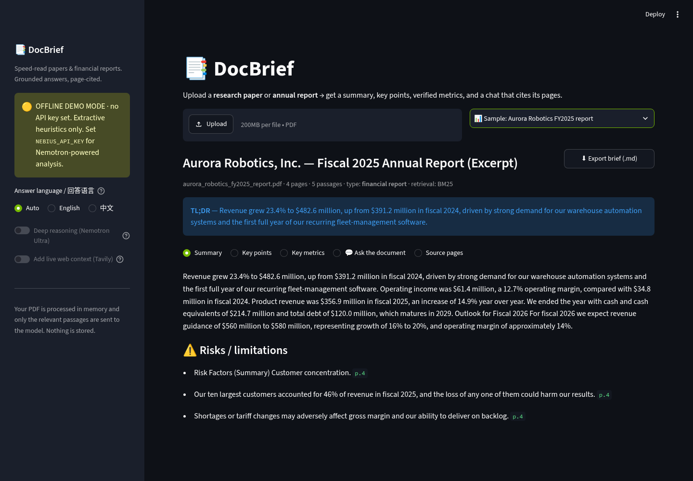
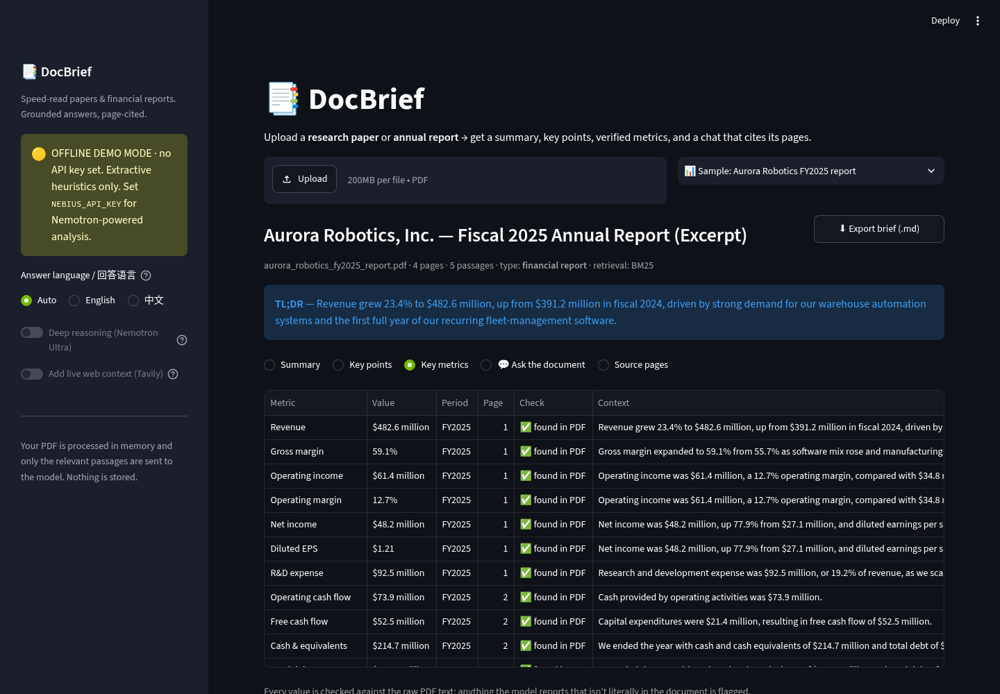
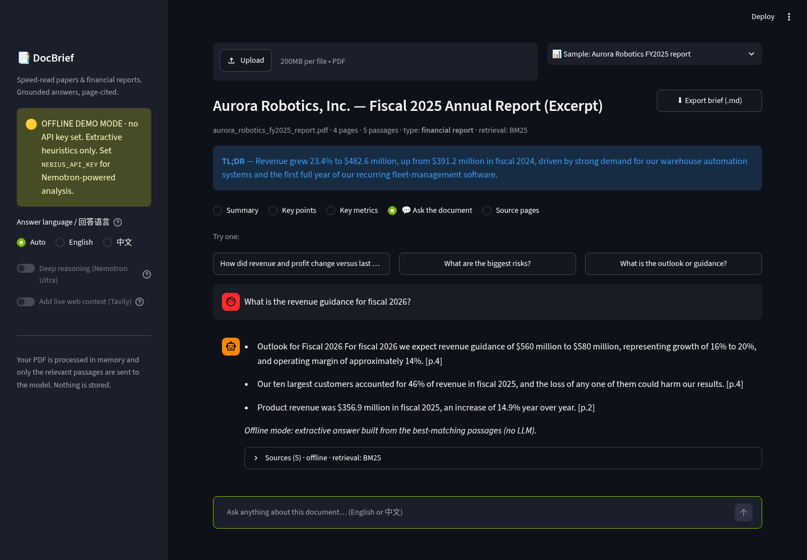
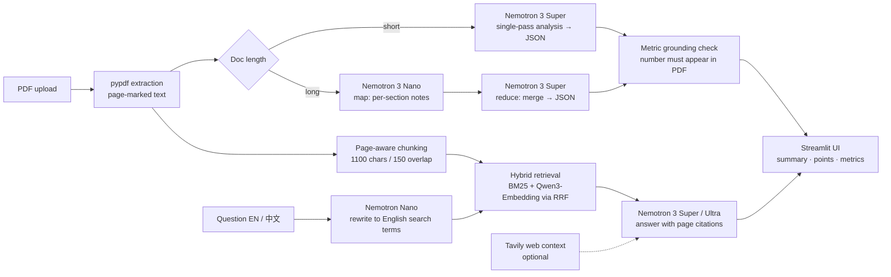

# 📑 DocBrief — speed-read any paper or annual report, with receipts

**Built for the Nebius × NVIDIA Global AI Hackathon · Track: Best Apps and Agents**

Upload a research paper or a financial report (PDF) and DocBrief gives you, in seconds:

- a **TL;DR + structured summary**,
- **key points and risks / limitations**, each tagged with its source page,
- a **key-metrics table** (revenue, margins, EPS, cash flow, guidance… or accuracy/dataset numbers for papers) where **every number is checked against the raw PDF text** and flagged `⚠️ not found — verify` if the model made it up,
- a **chat that answers in English or 中文** and cites the pages it used.

It is powered by **NVIDIA Nemotron open models served on Nebius Token Factory**.





## Why

Analysts, students and researchers drown in 80-page PDFs. Generic "chat with your PDF" tools hallucinate numbers — fatal when the document is a 10-K. DocBrief treats the PDF as the only source of truth: retrieval-grounded answers, page citations, and an automatic number-grounding check.

## How it works



| Piece | What it does |
|---|---|
| **Nemotron 3 Super** (`nvidia/nemotron-3-super-120b-a12b`) | Main model: analysis, metric extraction, grounded answers |
| **Nemotron 3 Nano** (`nvidia/NVIDIA-Nemotron-3-Nano-30B-A3B`) | Fast tier: map step over long documents, Chinese→English query rewriting |
| **Nemotron 3 Ultra** (`nvidia/Nemotron-3-Ultra-550b-a55b`) | Optional "Deep reasoning" toggle for hard questions |
| **Nebius Token Factory** | OpenAI-compatible inference endpoint for all of the above + embeddings |
| **Qwen3-Embedding-8B** (Nebius) | Dense vectors for hybrid retrieval (BM25-only fallback if unavailable) |
| **Tavily** (optional) | Live web context for questions that go beyond the document |

Design details worth knowing:

- **Grounding check** (`docbrief/metrics.py`): every reported metric value must literally appear in the PDF text; otherwise it is flagged in the UI.
- **Hybrid retrieval** (`docbrief/retrieval.py`): BM25 (with CJK bigrams for Chinese) fused with dense embeddings by Reciprocal Rank Fusion.
- **Map-reduce** for long filings: Nano analyses 36k-char sections, Super merges the notes.
- **Robust JSON**: strips `<think>` blocks from reasoning models, extracts the first balanced JSON object, retries once.
- **Privacy**: PDFs are processed in memory; only relevant passages are sent to the model.

## Run it

```bash
git clone <this repo> && cd nebius-hack
python -m venv .venv && source .venv/bin/activate     # Windows: .venv\Scripts\activate
pip install -r requirements.txt
streamlit run app.py
```

With no API key the app starts in **offline demo mode** (extractive heuristics, no LLM) so you can click through everything immediately — pick a sample from the dropdown.

### Live mode (Nebius + NVIDIA Nemotron)

1. Get an API key at <https://tokenfactory.nebius.com> (Nebius Token Factory → API keys).
2. `cp .env.example .env` and set `NEBIUS_API_KEY=...` (everything else has defaults; see `.env.example`).
3. Optional smoke test of the models and embeddings: `python scripts/check_nebius.py`
4. `streamlit run app.py` — the sidebar badge turns to **LIVE**.

| Env var | Purpose | Default |
|---|---|---|
| `NEBIUS_API_KEY` | **Required for live mode** | – |
| `NEBIUS_MODEL` / `NEBIUS_BASE_URL` | Main model + its endpoint | Nemotron 3 Super / `https://api.tokenfactory.us-central1.nebius.com/v1/` |
| `NEBIUS_FAST_MODEL` / `NEBIUS_FAST_BASE_URL` | Fast model | Nemotron 3 Nano / `https://api.tokenfactory.nebius.com/v1/` |
| `NEBIUS_DEEP_MODEL` | Deep-reasoning model | Nemotron 3 Ultra |
| `NEBIUS_EMBED_MODEL` / `NEBIUS_EMBED_BASE_URL` | Embeddings | Qwen3-Embedding-8B |
| `DOCBRIEF_MODE` | `auto` / `live` / `mock` | `auto` |
| `TAVILY_API_KEY` | Optional web context | – |

All default model IDs were verified against Nebius `GET /v1/models` (Oct 28, 2026) and exercised end-to-end: `nvidia/nemotron-3-super-120b-a12b`, `nvidia/NVIDIA-Nemotron-3-Nano-30B-A3B`, `nvidia/Nemotron-3-Ultra-550b-a55b`, `Qwen/Qwen3-Embedding-8B`. If your account exposes a model under a different ID or region, just override the variables above — no code changes.

Note: Nemotron are reasoning models, so JSON calls use a generous `max_tokens` budget (reasoning tokens count against it); a truncated reply is detected and retried rather than half-parsed.

### CLI and tests

```bash
python scripts/cli.py samples/aurora_robotics_fy2025_report.pdf -q "What is the FY2026 guidance?"
python -m pytest -q          # 10 tests, no network / key needed
python scripts/make_sample_pdfs.py   # regenerate the (fictional) sample PDFs
```

## Repo layout

```
app.py                 Streamlit UI
docbrief/              config · pdf_loader · chunking · retrieval · llm · live · mock · metrics · prompts · report
samples/               two fictional sample PDFs (a company annual report, an ML paper)
scripts/               cli.py · check_nebius.py · make_sample_pdfs.py
tests/                 core + live-engine-with-fake-LLM tests
docs/screenshots/      UI screenshots
```

The sample documents are entirely fictional (Aurora Robotics, EarnRAG) and exist only for demos.

## License

MIT — see [LICENSE](LICENSE).
