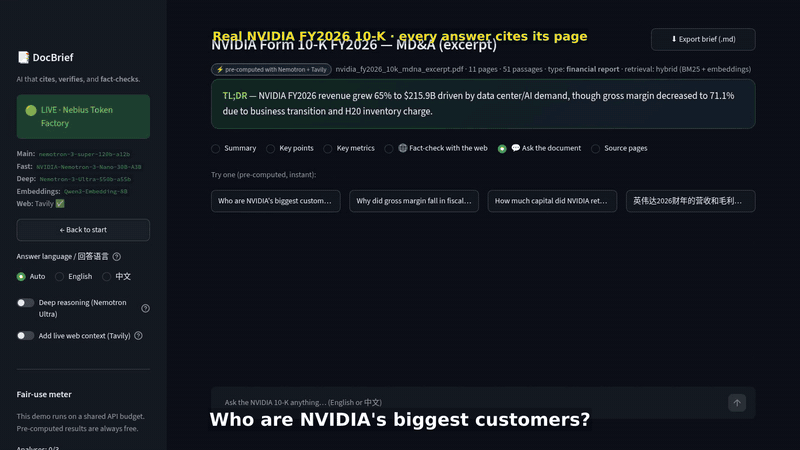
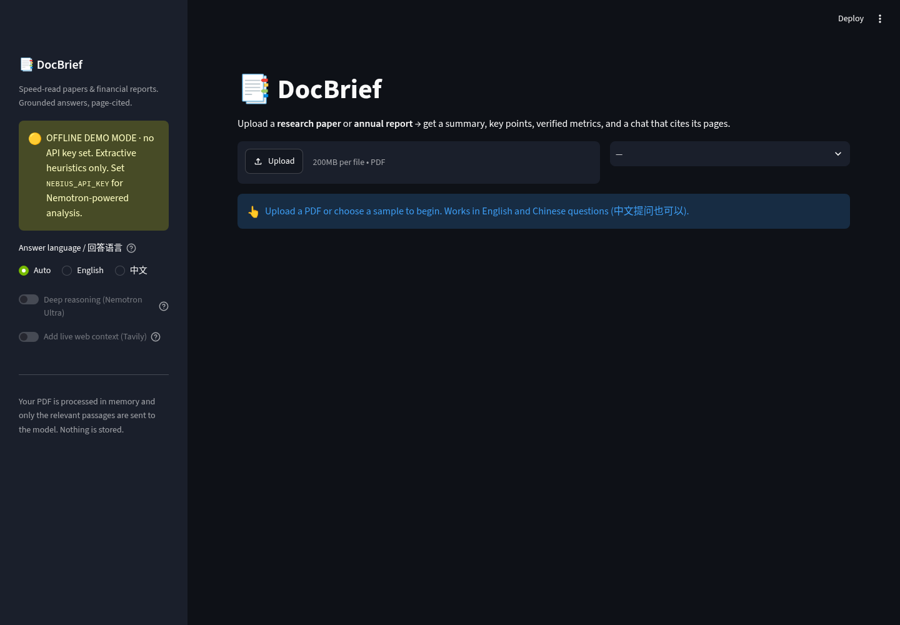
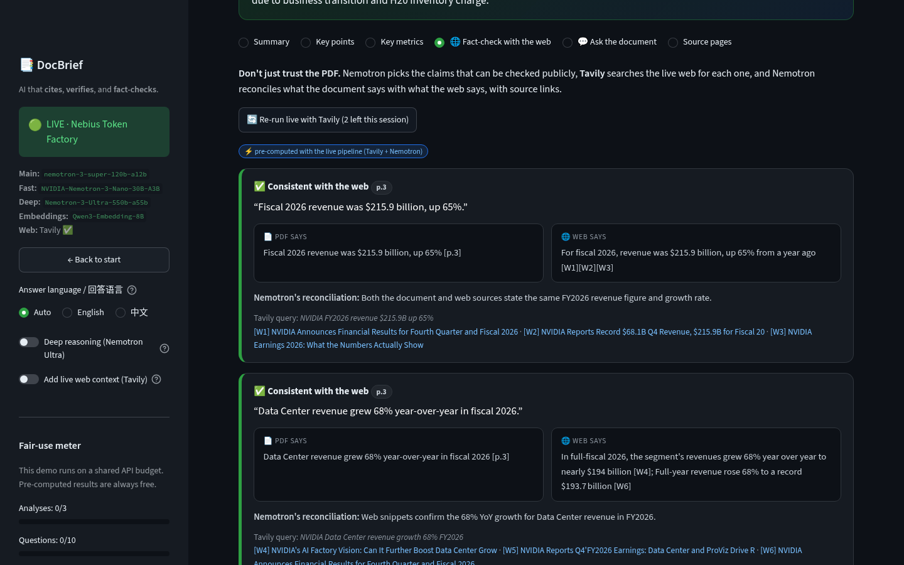
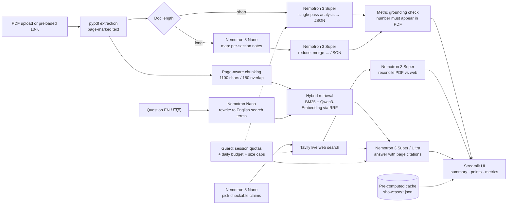

# 📑 DocBrief — Ask any 10-K. Get the page.

**AI that cites, verifies, and fact-checks.** Built for the Nebius × NVIDIA Global AI Hackathon · Track: Best Apps and Agents

> ### ▶ Try it live: **https://docbrief.streamlit.app**
> The demo opens on a **real NVIDIA 10-K** (FY2026 MD&A, pulled from SEC EDGAR) with the analysis, Q&A and web fact-check **pre-computed by Nemotron + Tavily, so loading it is instant and costs nothing**. You can then ask it new questions live, or upload your own PDF (within fair-use limits).
> 🎬 Demo video (2:33): [`demo/docbrief_demo_v3.mp4`](demo/docbrief_demo_v3.mp4) (also on YouTube, see the Devpost page)



| | |
|---|---|
| 🎯 **Cites every answer** | Hybrid retrieval (BM25 + Qwen3 embeddings) returns the exact passages; every claim carries a `[p.N]` page citation. |
| ✅ **Verifies every number** | Each metric the model reports must literally appear in the PDF text, otherwise it is flagged `⚠️ not found — verify`. |
| 🌐 **Fact-checks the web** | Nemotron Nano picks checkable claims, **Tavily** searches the live web, Nemotron Super reconciles *PDF vs web* with sources. |
| 🇨🇳 **Bilingual** | Ask in English or 中文 about an English filing; answers cite pages either way. |






## How it maps to the judging criteria

| Criterion | What to look at |
|---|---|
| **Technological implementation** | Three **NVIDIA Nemotron** tiers on **Nebius Token Factory**, each used for what it is good at: **Nano** (30B-A3B) for claim planning, query rewriting and the map step over long filings; **Super** (120B-A12B) for analysis, grounded Q&A and PDF-vs-web reconciliation; **Ultra** (550B) behind a "Deep reasoning" toggle. **Qwen3-Embedding-8B** (Nebius) powers dense retrieval, fused with BM25 by Reciprocal Rank Fusion. **Tavily** is a runtime dependency of the fact-check. Verification is code, not prompting: a number-grounding check plus tolerant JSON parsing. 27 offline tests (including the live engine with a fake LLM and a Streamlit AppTest smoke test). |
| **Design / UX** | One-click preloaded real filing, three feature cards, metric cards with `found in PDF` badges, side-by-side *PDF says / web says* fact-check cards, page chips and expandable source passages, EN/中文 toggle, a visible fair-use meter. |
| **Impact** | Analysts, students and investors lose hours to 80-page PDFs, and generic chat-with-PDF tools quietly invent numbers, which is fatal for a 10-K. DocBrief makes the reader's trust checkable: each answer links to its page, each figure to the raw text, each public claim to the web. |
| **Idea** | A "reader with receipts": retrieval-grounded answers + deterministic number verification + live web reconciliation, in one flow, bilingual, and safe to host publicly on a small budget. |

## How it works



| Piece | What it does |
|---|---|
| **Nemotron 3 Super** (`nvidia/nemotron-3-super-120b-a12b`) | Main model: analysis, metric extraction, grounded answers |
| **Nemotron 3 Nano** (`nvidia/NVIDIA-Nemotron-3-Nano-30B-A3B`) | Fast tier: map step over long documents, Chinese→English query rewriting |
| **Nemotron 3 Ultra** (`nvidia/Nemotron-3-Ultra-550b-a55b`) | Optional "Deep reasoning" toggle for hard questions |
| **Nebius Token Factory** | OpenAI-compatible inference endpoint for all of the above + embeddings |
| **Qwen3-Embedding-8B** (Nebius) | Dense vectors for hybrid retrieval (BM25-only fallback if unavailable) |
| **Tavily** (runtime API call) | Powers **Fact-check with the web** (live search for each checkable claim) and optional web context in Q&A |

### 🌐 Fact-check with the web (Tavily)
A document can be internally consistent and still wrong about the world. The **Fact-check with the web** view closes that gap with a live runtime call to the [Tavily Search API](https://tavily.com):

1. **Nemotron Nano** reads the document and picks up to 3 claims that can be checked publicly (market size, growth rates, benchmarks, facts about real companies) and writes a search query for each, ignoring a private or fictional company's own numbers.
2. **Tavily** searches the live web for each claim (top results, de-duplicated, labelled `W1…Wn`).
3. **Nemotron Super** reconciles *what the PDF says (with its page)* against *what the web says (with the source)* and returns a verdict: ✅ consistent · ⚠️ differs · 🔍 no web evidence.

The UI shows both sides next to each other with the PDF page citation and clickable web sources, so a reader can see where the document disagrees with the outside world (e.g. the sample report claims 6% market growth; the web says roughly 11–15%). The Q&A tab can also pull in Tavily snippets via the sidebar toggle. Without a Tavily key the app still works; the view just explains what it needs. CLI: `python scripts/factcheck_cli.py samples/aurora_robotics_fy2025_report.pdf`.

Design details worth knowing:

- **Grounding check** (`docbrief/metrics.py`): every reported metric value must literally appear in the PDF text; otherwise it is flagged in the UI.
- **Hybrid retrieval** (`docbrief/retrieval.py`): BM25 (with CJK bigrams for Chinese) fused with dense embeddings by Reciprocal Rank Fusion.
- **Map-reduce** for long filings: Nano analyses 36k-char sections, Super merges the notes.
- **Robust JSON**: strips `<think>` blocks from reasoning models, extracts the first balanced JSON object, retries once.
- **Privacy**: PDFs are processed in memory; only relevant passages are sent to the model.


## The showcase document

The preloaded demo is **NVIDIA Corporation's Form 10-K for fiscal 2026** (period ended Jan 25, 2026, filed 2026-02-25, accession 0001045810-26-000021), **Item 7 (MD&A) and the start of Item 7A, as an 11-page excerpt** (page 1 is a disclosure cover). Source: [SEC EDGAR](https://www.sec.gov/Archives/edgar/data/1045810/000104581026000021/nvda-20260125.htm). It is a public filing; page numbers in the app refer to the excerpt.

The analysis, four example questions (including one in Chinese) and the Tavily fact-check were computed once with `scripts/build_showcase.py` and shipped as `showcase/nvidia_fy2026_mdna.json` (embeddings included, validated by a chunk hash). Serving them costs **zero API calls**.

## Public-demo protections (the key is shared)

| Layer | Default |
|---|---|
| Pre-computed showcase | Summary, metrics, fact-check and 4 questions served from cache: free |
| Per-session quotas | 3 analyses · 10 questions · 2 deep (Ultra) questions · 2 live fact-checks |
| Input limits | PDF ≤ 15 MB (also enforced by Streamlit `maxUploadSize`), ≤ 80 pages, ≤ 150k analysed characters (map-reduce capped), ≤ 450 embedded chunks, questions ≤ 600 characters |
| Global daily budget | 400 units per UTC day shared by all visitors (analysis 12, question 2, deep 8, fact-check 8). When it is spent the app keeps serving pre-computed results only |
| Secrets | Keys come from `st.secrets` / environment only, never from the repo |

Everything is overridable with `DOCBRIEF_*` variables (see `.streamlit/secrets.toml.example`). Without any key the app runs in offline mock mode.

## Deploy on Streamlit Community Cloud

1. Push the repo (already on GitHub), then in [share.streamlit.io](https://share.streamlit.io) choose **New app → this repo → branch `main` → main file `app.py`**. `.python-version` (3.12) and the pinned `requirements.txt` are picked up automatically.
2. **Advanced settings → Secrets**:
   ```toml
   NEBIUS_API_KEY = "…"
   TAVILY_API_KEY = "…"    # optional, enables live web fact-checks
   ```
3. Deploy, then paste the app URL into the `https://docbrief.streamlit.app` placeholder at the top of this README.

## Run it

```bash
git clone <this repo> && cd nebius-hack
python -m venv .venv && source .venv/bin/activate     # Windows: .venv\Scripts\activate
pip install -r requirements.txt
streamlit run app.py
```

With no API key the app starts in **offline demo mode** (extractive heuristics, no LLM) so you can click through everything immediately — pick a sample from the dropdown.

### Live mode (Nebius + NVIDIA Nemotron)

1. Get an API key at <https://tokenfactory.nebius.com> (Nebius Token Factory → API keys).
2. `cp .env.example .env` and set `NEBIUS_API_KEY=...` (everything else has defaults; see `.env.example`).
3. Optional smoke test of the models and embeddings: `python scripts/check_nebius.py`
4. `streamlit run app.py` — the sidebar badge turns to **LIVE**.

| Env var | Purpose | Default |
|---|---|---|
| `NEBIUS_API_KEY` | **Required for live mode** | – |
| `NEBIUS_MODEL` / `NEBIUS_BASE_URL` | Main model + its endpoint | Nemotron 3 Super / `https://api.tokenfactory.us-central1.nebius.com/v1/` |
| `NEBIUS_FAST_MODEL` / `NEBIUS_FAST_BASE_URL` | Fast model | Nemotron 3 Nano / `https://api.tokenfactory.nebius.com/v1/` |
| `NEBIUS_DEEP_MODEL` | Deep-reasoning model | Nemotron 3 Ultra |
| `NEBIUS_EMBED_MODEL` / `NEBIUS_EMBED_BASE_URL` | Embeddings | Qwen3-Embedding-8B |
| `DOCBRIEF_MODE` | `auto` / `live` / `mock` | `auto` |
| `TAVILY_API_KEY` | Enables **Fact-check with the web** + web context in Q&A (Tavily Search API) | – |

All default model IDs were verified against Nebius `GET /v1/models` (Oct 28, 2026) and exercised end-to-end: `nvidia/nemotron-3-super-120b-a12b`, `nvidia/NVIDIA-Nemotron-3-Nano-30B-A3B`, `nvidia/Nemotron-3-Ultra-550b-a55b`, `Qwen/Qwen3-Embedding-8B`. If your account exposes a model under a different ID or region, just override the variables above — no code changes.

Note: Nemotron are reasoning models, so JSON calls use a generous `max_tokens` budget (reasoning tokens count against it); a truncated reply is detected and retried rather than half-parsed.

### CLI and tests

```bash
python scripts/cli.py samples/aurora_robotics_fy2025_report.pdf -q "What is the FY2026 guidance?"
pip install -r requirements-dev.txt && python -m pytest -q   # 27 tests, no network / key needed
python scripts/make_sample_pdfs.py   # regenerate the (fictional) sample PDFs
```

## Repo layout

```
app.py                 Streamlit UI (landing, preloaded showcase, upload flow)
docbrief/              config · pdf_loader · chunking · retrieval · llm · live · mock · metrics · prompts · report · tavily · factcheck · guard · showcase
samples/               real NVIDIA 10-K excerpt + two fictional sample PDFs (a company annual report, an ML paper)
showcase/              pre-computed analysis / Q&A / fact-check cache for the preloaded 10-K
scripts/               cli.py · build_showcase.py · check_nebius.py · factcheck_cli.py · make_sample_pdfs.py
tests/                 core + live-engine-with-fake-LLM tests
docs/screenshots/      UI screenshots
```

The Aurora Robotics and EarnRAG samples are entirely fictional; the NVIDIA excerpt is a real public SEC filing.

## License

MIT — see [LICENSE](LICENSE).
